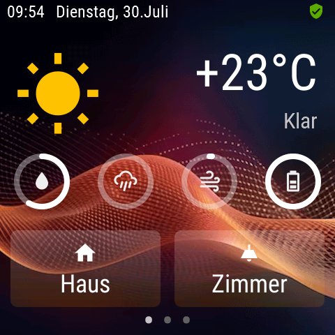
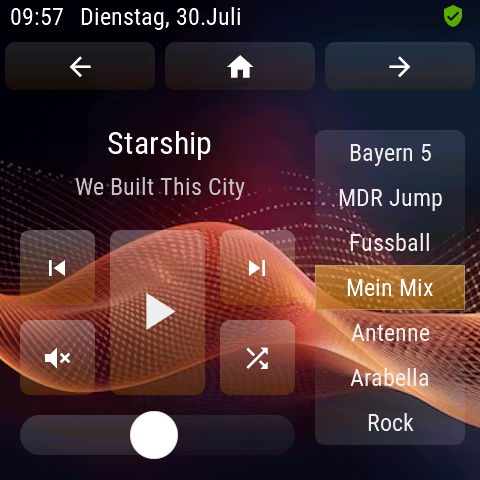

# 🖵 Raumdisplay (Room Display)

[](https://wilkware.de/module/raumdisplay/)
[](https://www.symcon.de/service/dokumentation/entwicklerbereich/sdk-tools/sdk-php/)
[](https://www.symcon.de/produkt/)
[](https://github.com/Wilkware/RoomDisplay)
[](https://creativecommons.org/licenses/by-nc-sa/4.0/)
[](https://github.com/Wilkware/RoomDisplay/actions)

Das Modul verbindet ein openHASP-Display über MQTT mit dem IPS-System. Die für das Display gestalteten Seiten und ihren Objekten können mit Variablen oder Skripten von IPS synchronisiert werden.

   

## Inhaltverzeichnis

1. [Funktionsumfang](#user-content-1-funktionsumfang)
2. [Voraussetzungen](#user-content-2-voraussetzungen)
3. [Installation](#user-content-3-installation)
4. [Einrichtung](#user-content-4-einrichtung)
5. [Statusvariablen](#user-content-5-statusvariablen)
6. [Darstellungen](#user-content-6-darstellungen)
7. [Visualisierung](#user-content-7-visualisierung)
8. [Befehlsreferenz](#user-content-8-befehlsreferenz)
9. [Versionshistorie](#user-content-9-versionshistorie)

### 1. Funktionsumfang

Das Modul übersetzt Aktionen und Ereignisse in Symcon und aktualisiert umgekehrt die Variablen in Symcon zur Darstellung auf 
dem Display.

<details>
<summary>Derzeit werden folgende UI-Objekte unterstützt:</summary>

* Arc
* Bar
* Button
* Checkbox
* Dropdown
* Gauge
* Image
* Label
* LED Indicator
* Line Meter
* MessageBox
* Object
* Roller
* Slider
* Spinner
* Switch
* Toggle Button

</details>

Was macht bzw. was kann das Modul?

- Mapping von IPS-Werten auf UI-Objekte im Mini-Display
- Aktionen auf dem Display werden nach IPS gesendet
- Verschiedenste Konfigurationsmöglichkeiten zur visuellen Darstellung der Werte
- Unterstützt verschiedene Displayformate und Layouts.
- Übergabe der Aktion und Ausführung via Script
- Abfrage von (Status-)Informationen
- Ausführung von OpenHASP System- bzw. Globalen Kommandos
- Automatische Schaltung für Helligkeit und Einbrennschutz
- Verwaltung, Prüfung und Sicherung des Seitenlayouts
- Automatische Umwandlung von Seitenlayout in Objektliste
- Import und Export von Objektkonfigurationen
- Unterstützung der TileVisu via HTML-SDK

### 2. Voraussetzungen

* Symcon ab Version 8.1

### 3. Installation

* Über den Modul Store das Modul _Raumdisplay_ installieren.
* Alternativ über das Modul Control folgende URL hinzufügen.  
`https://github.com/Wilkware/RoomDisplay` oder `git://github.com/Wilkware/RoomDisplay.git`

### 4. Einrichtung

* Unter 'Instanz hinzufügen' ist das _Raumdisplay_-Modul unter dem Hersteller '(Geräte)' aufgeführt.

__Konfigurationsseite__:

Einstellungsbereich:

> 🖼️ Anzeigegerät ...

Name                        | Beschreibung
--------------------------- | ----------------------------------
Gerätenamen                 | Name des Gerätes (= Hostname)
Geräteadresse               | IP ist optional , aber ohne gehen Downloads von Screenshots und der Designdatei (pages.jsonl) nicht.

> 📄 Seitenaufbau ...

Name                        | Beschreibung
--------------------------- | ----------------------------------
Datei (pages.jsonl)         | JSONL formatierter Inhalt zur Synchronisierung des Seitenaufbaus
HERUNTERLADEN¹              | Schalter um den Seitenaufbau vom Gerät herunterzuladen
HOCHRLADEN²                 | Schalter um den Seitenaufbau zum Gerät senden.
SICHERN¹                    | Schalter um den Seitenaufbau vom Gerät herunterzuladen und in eine Datei zu schreiben (Dateiname mit Datum, z. B. `20261011_plate01_pages.jsonl`).
PRÜFEN²                     | Schalter um den Inhalt des Seitenaufbaus auf JSONL Konformität zu prüfen.
EINLESEN³                   | Startet den Prozess zum Einlesen und Umwandeln des Seitenaufbaus in eine Objektzuordnung.

¹) Bei dieser Aktion werden die Daten direkt vom Gerät (Display) heruntergeladen und weiterverarbeitet.  
²) Bei dieser Aktion werden die aktuell im Konfigurationsformular angezeigten Daten verwendet, ungeachtet ihres Speicherstatus.  
³) Bei dieser Aktion werden die aktuell gespeicherten Daten der Instanz verwendet (müssen nicht mit den aktuell angezeigten Daten übereinstimmen).  

__Optionen beim Einlesen:__

Option                                       | Beschreibung
-------------------------------------------- | ----------------------------------
Nur neue Objekte anlegen                     | Legt für Objekte des Seitenaufbaus, die noch nicht in der Objektliste stehen, einen neuen Eintrag an
... Objekte mit eigener Aktion               | Überspringt Objekte mit `action` (z. B. Navigationsbuttons `p+`, `p-`) – Standard: an
... Deaktivierte oder nicht klickbare Objekte | Überspringt Objekte mit `"enabled":0` oder `"click":0`
... Ausgeblendete Objekte                    | Überspringt Objekte mit `"hidden":1`
... Objekte auf Seite 0                      | Überspringt globale Objekte, die auf allen Seiten angezeigt werden (z. B. Kopf- oder Fußzeile)
... Bilder und Basisobjekte                  | Überspringt Objekte vom Typ `img` und `obj` (z. B. Hintergrundbilder, Rahmen)
... Mit Tag "skip" markierte Objekte         | Überspringt Objekte mit `"tag":"skip"` oder `"tag":{"skip":1}` – Standard: an
Vorhandene Objekte überschreiben             | Korrigiert den Typ bereits zugeordneter Objekte
Alle nicht vorhandenen Objekte löschen       | Entfernt Einträge, deren Objekt nicht mehr im Seitenaufbau existiert

Die Filter gelten nur für neue Objekte, bereits zugeordnete Einträge bleiben unverändert.
Mit SIMULIEREN wird nichts übernommen; das Popup bleibt offen und zeigt das Ergebnis direkt an – die Anzahl je Aktion, die übersprungenen Objekte je Grund und die Liste der betroffenen Objekte (z. B. `p1b12 (label) "Küche"`). So lassen sich die Optionen anpassen und erneut simulieren. STARTEN übernimmt das Ergebnis in die Objektliste, schließt das Popup und zeigt das Ergebnis als Meldung.
Für Objekte, die nie eine Zuordnung brauchen, ist die Markierung per Tag im Seitenaufbau am zuverlässigsten. Die Vorlagen der Widgets (Uhren) sind bereits so markiert, da das Modul diese Objekte selbst ansteuert:

```json
{"page":1,"id":2,"obj":"img","src":"L:/background.png","tag":"skip"}
```

> 🧩 Objektzuordnung ...

Name                        | Beschreibung
--------------------------- | ----------------------------------
Objekte                     | Tabelle zur Zuordnung zwischen UI-Objekt und Symcon-Variable bzw. -Skript
AUSWAHL¹                    | Schalter um den Zustand der Auswahlboxen umzukehren, Basis ist die Checkbox des ersten Elementes
LÖSCHEN¹                    | Schalter um selektierte Zeile zu löschen
DUPLIZIEREN¹                | Schalter um selektierte Zeile zu duplizieren (und gleich einzusortieren)
PRÜFEN¹                     | Schalter um die hinterlegten Eingaben (Berechnungen) eines ausgewählten Eintrag zu prüfen.
ÜBERTRAGEN¹                 | Öffnet ein Dialog um die zuvor selektierten Zeilen in eine Datei zu exportieren (z. B. `20261011_plate01_objects.json`), oder eine abgespeicherte Konfiguration aus einer Datei zu importieren.
NEUSORTIEREN²               | Schalter um die Liste endsprechend _Seite_ und _ID_ zu sortieren
ABGLEICHEN²                 | Schalter um die hinterlegten Objekte gegen den Inhalt des Seitenaufbaus zu prüfen.

¹) Diese Aktionen verwenden die aktuell ausgewählten Daten aus der Objektliste.  
²) Diese Aktionen verwenden alle Daten aus der Objektliste, unabhängig von ihrem Auswahlstatus.  

__Spalten der Objektliste:__

Spalte                      | Beschreibung
--------------------------- | ----------------------------------
☑️                          | Auswahl der Einträge für ÜBERTRAGEN (Export), AUSWAHL, LÖSCHEN usw.
Typ                         | Typ des UI-Objektes (siehe Tabelle unten)
Seite / Id                  | Seite und ID des UI-Objektes im Seitenaufbau (pages.jsonl), zusammen eindeutig
Kommentar                   | Freier Text, hilft bei vielen Zuordnungen den Überblick zu behalten
Beschriftung                | Ausdruck für den Text des Objektes – was genau gesetzt wird, hängt vom Typ ab
Wert                        | Ausdruck für den Wert des Objektes – was genau gesetzt wird, hängt vom Typ ab
Umrechnung                  | Ausdruck Symcon ➡️ Display, wird zuerst auf den Variablenwert angewendet
Rückrechnung                | Ausdruck Display ➡️ Symcon, bei Messagebox stattdessen die ID des auszuführenden Skriptes
Verknüpfung                 | Variable oder Skript in Symcon

__Ablauf Symcon ➡️ Display__ (bei Änderung der verknüpften Variable und beim Synchronisieren):

1. Der Variablenwert wird mit _Umrechnung_ umgerechnet (leer = unverändert, `-1` = nichts an das Display senden).
2. Das Ergebnis steht in _Beschriftung_ und _Wert_ als `{{val}}` zur Verfügung.
3. Sind _Beschriftung_ bzw. _Wert_ leer, wird das Ergebnis aus Schritt 1 direkt verwendet (sofern der Typ das vorsieht).

__Ablauf Display ➡️ Symcon__ (bei einem Ereignis auf dem Display, siehe Spalte _Rückmeldung_):

1. Der Wert vom Display (`val`) wird mit _Rückrechnung_ umgerechnet, der Text vom Display steht als `{{txt}}` zur Verfügung.
2. Ist ein Skript verknüpft, wird es ausgeführt und erhält `$_IPS['VALUE']` und `$_IPS['TEXT']`.
3. Ist eine Variable verknüpft, wird sie geschaltet (`RequestAction`, ohne Aktion `SetValue`). Ergibt die Rückrechnung `-1` oder liefert das Display keinen Wert, passiert nichts.

__Ausdrücke und Platzhalter:__

Alle Ausdrücke (Beschriftung, Wert, Umrechnung, Rückrechnung) sind PHP-Ausdrücke ohne `return` und Semikolon, z. B. `{{val}} > 20 ? 'warm' : 'kalt'`.
Ausdrücke ohne Platzhalter werden so behandelt:

* mit `%` als `sprintf`-Formatierung des Wertes, z. B. `%.1f °C`
* sonst als fester Wert, z. B. `true`, `1`, `'#FF0000'` oder `['Ja', 'Nein']`
* ist das kein gültiger PHP-Ausdruck, wird er als einfacher Text übernommen, z. B. `Licht an`

Platzhalter                 | Bedeutung                                      | Verfügbar in
--------------------------- | ---------------------------------------------- | ----------------------------------
`{{val}}`                   | Rohwert der Variable bzw. Ergebnis der Umrechnung, bei Rückrechnung der Wert vom Display | allen Spalten
`{{fmt}}`                   | Formatierter Wert der Variable (laut Darstellung bzw. Profil) | Umrechnung, Beschriftung, Wert
`{{txt}}`                   | Text vom Display (z. B. gewählter Eintrag eines Dropdowns) | Rückrechnung

Mit dem Schalter PRÜFEN lassen sich die Ausdrücke eines ausgewählten Eintrags mit dem aktuellen Variablenwert testen.

__Zuordnung je UI-Objekt:__

Typ           | Beschriftung setzt …            | Wert setzt …                                  | Rückmeldung an Symcon
------------- | ------------------------------- | --------------------------------------------- | ----------------------
Arc           | Text (`val_str`)                | Wert (`val`)                                  | bei jeder Wertänderung
Bar           | Farbe des Indikators (`bg_color10`) | Wert (`val`)                              | –
Button        | Text                            | –                                             | Drücken (`down`)¹
Checkbox      | Text                            | – (Wert wird immer als `val` gesetzt)         | Loslassen (`up`)
Dropdown      | –                               | gewählter Eintrag (`val`)                     | Auswahl geändert (`changed`)
Gauge         | –                               | Wert (`val`)                                  | –
Image         | –                               | Bildquelle (`src`)                            | –
Label         | Text                            | –                                             | –
LED Indicator | –                               | – (Bool-Variable: 0/255, sonst Wert als `val`) | –
Line Meter    | Text (`val_str`)                | Wert (`val`)                                  | –
MessageBox    | Meldungstext²                   | Buttons, z. B. `['Ja', 'Nein']` (Standard: OK) | Button gedrückt (`up`) ➡️ Skript aus Rückrechnung
Object        | Text (`val_str`)                | Hintergrundfarbe (`bg_color`), z. B. `'#FF0000'` | –
Roller        | –                               | gewählter Eintrag (`val`)³                    | Auswahl geändert (`changed`)
Slider        | Text (`val_str`)                | – (Wert wird immer als `val` gesetzt)         | Loslassen (`up`)
Spinner       | Text (`val_str`)                | Geschwindigkeit, negativ = gegen den Uhrzeigersinn³ | –
Switch        | –                               | Zustand (`val`)                               | Loslassen (`up`)
Toggle Button | Text                            | – (Wert wird immer als `val` gesetzt)         | Loslassen (`up`)

¹) Ein einfacher Button liefert keinen Wert – die _Rückrechnung_ muss den zu setzenden Wert liefern (z. B. `true`), oder es wird ein Skript verknüpft.  
²) Ohne Beschriftung wird keine Meldung angezeigt.  
³) Ohne Wert-Ausdruck wird nichts gesetzt.  

__Beispiele:__

Ziel                                         | Typ           | Beschriftung              | Wert                          | Umrechnung | Rückrechnung
-------------------------------------------- | ------------- | ------------------------- | ----------------------------- | ---------- | ------------
Temperatur mit Einheit anzeigen              | Label         | `{{fmt}}`                 |                               |            |
Licht schalten, Text je nach Zustand         | Toggle Button | `{{val}} ? 'An' : 'Aus'`  |                               |            |
Szene per Button aufrufen                    | Button        |                           |                               | `-1`       | `1`
Helligkeit 0–100 % auf Slider 0–255          | Slider        | `{{fmt}}`                 |                               | `{{val}} * 2.55` | `round({{val}} / 2.55)`
Fenster offen rot, geschlossen grün          | Object        |                           | `{{val}} ? '#FF0000' : '#00FF00'` |        |
Rückfrage mit Skript (ID 12345)              | MessageBox    | `'Garage schließen?'`     | `['Ja', 'Nein']`              |            | `12345`

> ✨ Visualisierung ...

Name                                   | Beschreibung
-------------------------------------- | ----------------------------------
Kachelhintergrundfarbe (online)        | Farbauswahl für den Zustand 'ONLINE'
Kachelhintergrundfarbe (offline)       | Farbauswahl für den Zustand 'OFFLINE'
Navigationsleiste anzeigen (Vor, Zurück, Weiter)?  | Schaltet die Anzeige der Navigationsbuttons an bzw. aus
Aktionsleiste anzeigen (Seiten löschen, Seiten neu laden, Synchronisieren, Neustart) | Schaltet die Anzeige der Aktionsbuttons an bzw. aus

> 🧰 Widgets ...

Name                                   | Beschreibung
-------------------------------------- | ----------------------------------
An / Aus (Analoguhr)                   | Aktualisierung der Uhrzeit an bzw-ausschalten
Seite (Analoguhr)                      | Seiten ID, auf welche sich die Uhr befindet
Stundenzeiger (Analoguhr)              | Gauge ID des Stundenzeigers
Minutenzeiger (Analoguhr)              | Gauge ID des Minutenzeigers
An / Aus  (Qlocktwo Earth)             | Aktualisierung der Uhrzeit an bzw-ausschalten
Seite (Qlocktwo Earth)                 | Seiten ID, auf welche sich die Uhr befindet
Startreihe (Qlocktwo Earth)            | Label ID der ersten durchnummerierten Textreihe
Hervorhebungsfarbe (Qlocktwo Earth)    | Farbe, welche zur hervorhebung der Uhrzeit genutzt werden soll
Präfix anzeigen (Qlocktwo Earth)       | Schalter, ob die Wörter "ES IST" immer hervorgehoben werden sollen
Suffix anzeigen (Qlocktwo Earth)       | Schalter, ob das Wort "UHR" immer hervorgehoben werden sollen (sonst nur wenn notwendig)
An / Aus (Fallblattuhr)                | Aktualisierung der Uhrzeit an bzw-ausschalten
Seite (Fallblattuhr)                   | Seiten ID, auf welche sich die Uhr befindet
Stundenfallblatt (Fallblattuhr)        | Start ID des Labels, welches die Stunden darstellt
Minutenfallblatt (Fallblattuhr)        | Start ID des Labels, welches die Minuten darstellt
An / Aus (HASP-Uhr)                    | Aktualisierung der Uhrzeit an bzw-ausschalten
Seite (HASP-Uhr)                       | Seiten ID, auf welche sich die Uhr befindet
Minutenkreis (HASP-Uhr)                | Objekt ID des Kreises(Arc), welches die Minuten darstellt

> ⚙️ Erweiterte Einstellungen ...

Name                                   | Beschreibung
-------------------------------------- | ----------------------------------
Hintergrundbeleuchtung automatisch schalten! | Schaltet die Beleuchtung in Abhängigkeit der zeitlichen Nutzung
Normal (kein Leerlauf)                 | Wert der Helligkeit bei normaler Nutzung des Displays
Kurzer Leerlauf                        | Wert der Helligkeit nach kürzeren Nicht-Nutzung des Displays
Langer Leerlauf                        | Wert der Helligkeit nach längerer Nicht-Nutzung des Displays
Variable für den dunklen Modus         | Variable (bool), welche den Dunkelmodus steuert (WAHR = AUS| FALSCH = AN)
Normal (Dunkelmodus)                   | Wert der Helligkeit bei normaler Nutzung des Displays
Kurzer Leerlauf (Dunkelmodus)          | Wert der Helligkeit nach kürzeren Nicht-Nutzung des Displays
Langer Leerlauf (Dunkelmodus)          | Wert der Helligkeit nach längerer Nicht-Nutzung des Displays
Einbrennschutz automatisch aktivieren! | Schalter, ob der Einbrennschutz automatisch im definierten Zyklus gestartet werden soll!
Zyklus                                 | Zeitlicher Zyklus in Minuten in dem der Einbrennschutz für 30 Sekunden eingeschaltet wird.
Hintergrundbeleuchtung dimmen          | Schaltet die Beleuchtung während des Einbrennschutzes (30s) auf die eingestellte Beleuchtungsstärke, solange sie kleiner ist als der Wert für den langen Leerlauf und nicht Null ist!
Im Ruhezustand keine Synchronisierung!  | Schaltet die Synchronisation im Leerlauf ab (idle->long)
Im Ruhezustand auf eine bestimmte Seite wechseln!   | Schalter,  ob im langen Leerlauf eine bestimmte Seite angezeigt werden soll!
Feste Seite                            | Statische Seitenummer auf welche gewechselt werden soll im langen Leerlauf-Modus
Dynmische Seite                        | Variable, welche die Seitenummer enthält auf welche gewechselt werden soll im langen Leerlauf-Modus
Seitenverzweigung                      | Boolsche Variable, welche entscheidet auf welche Seite gewechselt werden soll im langen Leerlauf-Modus
Seite (Wahr)                           | Seite im Zustand wahr
Seite (Flasch)                         | Seite im Zustand falsch
Im Ruhezustand durch die Seiten blättern!   | Schalter, ob im langem Leerlauf die Seiten durchgeblättert werden sollen!
Intervall                              | Zeitspanne zwischen den einzelnen Seitenwechseln in Minuten (1-60)
Popup-Meldung schließen nach           | Standardwert in Sekunden nachdem eine MessageBox automatisch geschlossen wird.
Nachricht an Skript weiterleiten:      | Leitet die Aktion bzw. das Ereignis direkt weiter. Die Daten können im Script mit der Variable $_IPS['Data'] empfangen und ausgewertet werden.
Nachrichten weiterleiten von:          | Welche Ereignisse weitergeleitet werden: nur zugeordnete Objekte (Standard), nur nicht zugeordnete Objekte oder alle Objekte. In $_IPS['Data'] zeigt 'Registered' (true/false), ob das Objekt in der Objektliste zugeordnet ist.

Aktionsbereich:

> 🚀 Aktion ausführen ...

* _Seiten neu laden_ - liest die pages.jsonl neu ein und rendert die Seiten neu
* _Seiten löschen_ - alle Seiten löschen
* _Synchronisieren_ - gerade in der Einstellung- bzw. Entwicklungsphase ein ganz wichtiger Button, er geht durch die Mappingliste und ruft für die verknüpften Variablen deren Werte ab und stellt sie dar. Diese Funktion wird auch immer aufgerufen wenn ein Gerät ONLINE geht! Gerade wenn man alles Seiten gelöscht hat und neu lädt ist der Button sehr hilfreich!
* _Neustart_ - Reboot des Gerätes

> 🧭 Seitennavigation ...

* _Vorher_, _Zurück_, _Weiter_ - eigentlich auch selbsterklärend, mit den Buttons kann man auf den Seiten navigieren

> ❓ Abfrage von ...

* _Stimmungslicht_ - Anzeige der aktuellen Moodlight-Einstellungen
* _Status_ - Anzeige der Status-Update-Infos
* _Bildschirmfoto_ - Erstellen und Speichern eines aktuellen Screenshots (aktuelle Seite) mit Datum und Uhrzeit im Dateinamen (z. B. `20261011_1530_plate01_screenshot.bmp`), siehe auch imgs Ordner im Modul

### 5. Statusvariablen

Die Statusvariablen werden automatisch angelegt. Das Löschen einzelner kann zu Fehlfunktionen führen.

Ident                       | Name                        | Typ     | Beschreibung
--------------------------- | --------------------------- | ------- | ------------------------------
Status                      | Status                      | Boolean | Verfügbarkeitsstatus des Displays
Idle                        | Leerlauf                    | Integer | Zeigt den Leerlaufzustand an
Backlight                   | Hintergrundbeleuchtung      | Integer | Wert der Hintergrundbeleuchtung
Page                        | Seite                       | Integer | Aktuell angezeigte Seite
Navigate                    | Navigiere                   | String  | Navigation zwischen den Seiten des Displays
Action                      | Aktion                      | Integer | Ausführen einer Aktion auf dem Display

### 6. Darstellungen

Die Darstellungen werden direkt an den Statusvariablen hinterlegt, es werden keine Profile angelegt.

Variable                    | Darstellung   | Werte
--------------------------- | ------------- | ------------------------------
Status                      | Wertanzeige   | Online (true), Offline (false)
Leerlauf                    | Wertanzeige   | Aus (0), Kurz (1), Lang (2)
Hintergrundbeleuchtung      | Schieberegler | 1 – 255 (Schrittweite 1)
Seite                       | Schieberegler | 1 – 12 (Schrittweite 1)
Navigiere                   | Aufzählung    | Vorher, Zurück, Weiter
Aktion                      | Aufzählung    | Seiten löschen, Seiten neu laden, Synchronisieren, Neustart

### 7. Visualisierung

Man könnte die Statusvariablen direkt in die Visualisierung verlinken.

### 8. Befehlsreferenz

```php
void WWXRD_DisableIdle(int $InstanzID, bool $disable);
```

Verhindert das automatische abschalten des Display (Hintergrundbeleuchtung).  
Wird _true_ übergeben geht das Display nicht mehr in den Leerlaufmodus; abschalten kann man es wieder mit _false_.  
Die Funktion liefert keinerlei Rückgabewert.

__Beispiel__: `WWXRD_DisableIdle(12345, true);`

```php
void WWXRD_SendCommand(int $InstanzID, string $command);
```

Sendet ein Kommando via MQTT an das Display.  
Die Funktion liefert keinerlei Rückgabewert.

__Beispiel__: `WWXRD_SendCommand(12345, '["p1b2.text=Hallo"]');`

```php
void WWXRD_SendJSONL(int $InstanzID, array $data);
```

Sendet JSON Lines (JSONL) via MQTT an das Display.  
Die Funktion liefert keinerlei Rückgabewert.

__Beispiel__: `WWXRD_SendJSONL(12345, ['page' => 1,'id' => 99),'obj' => 'msgbox','text' => 'A message box with two buttons','options' => ['Open','Close']]);`

### 9. Versionshistorie

v5.0.20261011
* _NEU_: Weiterleitung an ein Skript wahlweise für zugeordnete, nicht zugeordnete oder alle Objekte
* _NEU_: Rückmeldung beim Hochladen des Seitenlayouts (erfolgreich oder Fehler)
* _NEU_: Downloads mit Datum und Gerätenamen im Dateinamen (JJJJMMTT_Gerät_pages.jsonl, JJJJMMTT_Gerät_objects.json, JJJJMMTT_HHMM_Gerät_screenshot.bmp)
* _FIX_: Sicherheitslücke bei Berechnungen geschlossen – Texte vom Display können keinen Code mehr ausführen
* _FIX_: Werte mit Hochkomma (z.B. "Kinder's") führen in Berechnungen nicht mehr zu Fehlern
* _FIX_: Keine falschen Fehlermeldungen mehr im Log bei Objekten, die mit einem Skript verknüpft sind
* _FIX_: Gelöschte verknüpfte Objekte werden jetzt im Log gemeldet
* _FIX_: Display wird nicht mehr gedimmt, wenn der Leerlauf deaktiviert ist
* _FIX_: Konfiguration hängt nicht mehr, wenn das Display nicht erreichbar ist
* _FIX_: Messagebox mit hinterlegtem Skript startet dieses jetzt zuverlässig
* _FIX_: Unerwartete Nachrichten vom Display führen nicht mehr zu Fehlern
* _FIX_: Leere Auswahlfelder (Objekt, Skript) werden korrekt ignoriert
* _FIX_: Verknüpfte Objekte werden erst nach dem Systemstart geprüft (kein falscher Fehlerstatus beim Neustart)
* _FIX_: Darstellungen der Statusvariablen bereinigt (nur noch notwendige Parameter)
* _FIX_: Umrechnung `-1` verhindert jetzt auch bei Variablenänderungen das Senden an das Display
* _FIX_: Ausdrücke ohne Platzhalter liefern feste Werte mit richtigem Typ (z. B. `true`, `1`, `['Ja', 'Nein']` für MessageBox-Buttons), sonst Text
* _FIX_: Rückrechnung wird jetzt auch bei Arc angewendet
* _NEU_: Dokumentation der Objektzuordnung je UI-Objekt, Platzhalter und Beispiele
* _NEU_: Vorlagen der Widgets (Analoguhr, QLOCKTWO, Fallblattuhr, HASP-Uhr) mit `"tag":"skip"` markiert
* _NEU_: Einlesen mit Filtern für neue Objekte (eigene Aktion, deaktiviert, ausgeblendet, Seite 0, Bilder/Basisobjekte, Tag "skip") und Ergebnisliste der betroffenen Objekte
* _FIX_: Kleinere Codeoptimierungen und Aufräumarbeiten

v4.1.20260828
* _FIX_: Problem in MQTT Pipeline behoben

v4.1.20260818
* _NEU_: Unterstützung für BAR (über Beschriftung (optional) => Farbwert des Indikators, über Wert => Fortschrittswert)
* _NEU_: Umstellung aller Profile auf Darstellungen
* _FIX_: Fehler in Synchonize im Zusammenspiel mit Skripten behoben
* _FIX_: Umstellung auf namespaced Bibliotheken
* _FIX_: Kleinere Codeoptimierungen

v4.0.20251221
* _NEU_: Projektumstrukturierung hin zu einer globalen CI/CD-Pipeline
* _NEU_: Kompatibilität auf IPS 8.1 hoch gesetzt
* _NEU_: Umstellung auf IPSModuleStrict
* _NEU_: Kompatibilität für IPS 8.2 vorbereitet
* _NEU_: Umschalten im Leerlauf unterstützt jetzt 3 Modi (Fix, Dynamisch und Verzweigung)
* _NEU_: Modulversion wird in Quellcodesektion angezeigt
* _FIX_: DarkMode wird nach Antiburn wieder korrekt hergestellt
* _FIX_: SendJSONL behandelt Backslash's jetzt korrekt
* _FIX_: Umstellung auf RegisterHook aus SDK
* _FIX_: Diverse Fehlerbehebungen
* _FIX_: Bibliotheksfunktionen angeglichen

v3.8.20250515
* _NEU_: DarkMode für Leerlauf
* _FIX_: Register/Unregister von Objekten korrigiert

v3.7.20250318
* _NEU_: Konfigurationsformular überarbeitet (Aktionshinweise, Anordnung uvm.)
* _NEU_: Löschen von ausgewählten Objektmappings (Mehrfachauswahl)
* _NEU_: Duplizierung von ausgewählten Objektmappings (Mehrfachauswahl)
* _NEU_: Neue Prüfungsmethodik eingeführt (nur noch über Checkbox); Mehrfachauswahl listet fehlerbehaftete Mappings auf; Einfachauswahl zeigt einzelne Verarbeitungsergebnise an
* _NEU_: Neues Uhren-Widgets HASP
* _NEU_: Vorlagen für die Widgets können jetzt direkt angezeigt werden (Button) und dadurch einfaches Kopieren ermöglicht
* _FIX_: Fehler in Prüfung korrigiert
* _FIX_: Aufwachen beschleunigt (Hintergrundlicht vor Synchronisierung)
* _FIX_: Einige Übersetzungsfehler korrigiert

v3.6.20250310
* _NEU_: Unterstützung von Uhren-Widgets für Leerlaufzeiten
* _NEU_: Vorlagen für die Widgets Analoguhr, Qlocktwo Earth und Fallblattuhr (docs Verzeichnis)
* _FIX_: Status Profil - vertauschte Farben - korrigiert

v3.5.20250305
* _NEU_: Neuer Platzhalter {{fmt}} für profilformatierte Werte wird jetzt auch bei Wert und Beschriftung unterstützt
* _NEU_: Seiten(bereichs)angabe für automatisches Durchblättern der Seiten im Leerlauf
* _NEU_: Freie Definition einer Seite, welche beim Seitenwechsel im Leerlauf dargestellt/geschaltet werden soll
* _FIX_: Veraltete Konfigurationsangaben ersetzt

v3.4.20250303
* _NEU_: Auswahl der zu aktivierenden Seite im Leerlauf
* _NEU_: Automatisches durchblättern der Seiten im Leerlauf
* _FIX_: Bei Aktivierung der Löschfunktion beim Einlesen des Seitenlayouts wurden alle Zurodnungen gelöscht

v3.3.20250220
* _NEU_: Auswahl(umkehr) für Objektkonfiguration

v3.2.20250218
* _NEU_: Import und Export von Objektkonfigurationen zum Austausch zwischen verschiedenen Instanzen.

v3.1.20250214
* _NEU_: Definierte Objekte mit dem Inhalt des Seitenaufbaus abgleichen (Ausgabe: Liste der nicht definierten UI-Elemente).
* _NEU_: Einlesen und Umwandeln des Seitenaufbaus in die Objektzuordnung (Neue anlegen, Fehlerhafte korrigieren und nicht vorhandene löschen).
* _NEU_: Statusvariablen für Navigation und Aktionen (bessere Unterstützung von IPSView)
* _FIX_: Variablenupdates werden jetzt nur verarbeitet wenn eine wirkliche Änderung vorliegt (neuer Wert).
* _FIX_: Variablenupdates werden jetzt nur im Status Online verarbeitet.
* _FIX_: Übersetzungen in TileVisu korrigiert.
* _FIX_: Fehler in Debugausgabe korrigiert.

v3.0.20250205
* _NEU_: Unterstützung für TileVisu (Status, Navigation, Actions)
* _NEU_: Zeiteinstellung für automatisches Schliessen von Messageboxen
* _NEU_: Beispielseiten und -bilder erweitert
* _FIX_: Beim (manuellen) Syncronisationsdurchlauf werden Messageboxen unterdrückt.

v2.1.20250131
* _NEU_: Unterstützung für MESSAGEBOX (über Beschriftung => Text, über Wert => Buttons, über Rückrechnung => ScriptID für senden der Event-Werte)
* _FIX_: Objektzuordnungstabelle nutzt jetzt gesamte verfügbare Breite im Konfigurationsdialog

v2.0.20241129
* _NEU_: Rudimentäres Prüfen der Umrechnungen pro Verlinkung
* _NEU_: Verhalten von Spinner erweitert, Speed & Direction über (+/-) Wert und Beschriftung hinzugefügt
* _FIX_: Interner Umbau der Wertübername für Dorpdown, Gauge und Switch (Vereinheitlichung)

v1.9.20241122
* _NEU_: Unterstützung für SPINNER (über Beschriftung kann Drehrichtung, über Wert die Geschwindigkeit gesetzt werden)
* _NEU_: Schaltung der Hintergrundbeleutung während des Einbrennschutzes
* _NEU_: Prüfung der Objektverlinkung umgebaut bzw. eingeführt, Status bei Fehler wird auf 201 gesetzt
* _FIX_: Synchronisatzionslauf testet auf Existieren des verlinkten Objekts
* _FIX_: Synchronisatzionsfehler bei Skript-Verlinkungen behoben (kein -1 bei Umrechnung gesetzt)
* _FIX_: Fehler beim Duplizieren behoben

v1.8.20241110
* _NEU_: Neue Sektion zum verwalten des Seitenaufbaus (Layout)
* _FIX_: Beispielbilder teilweise umbennant/korriegiert
* _FIX_: Dokumentation vervollständigt

v1.7.20241106

* _NEU_: Buttons für das Sortieren der Objekt-Einträge nach _Seite_ und _ID_
* _NEU_: Buttons für das Duplizieren eines Mapping-Eintages
* _NEU_: Funktion _DisableIdle_ hinzugefügt (Hilfreich bei Konfigurations-Sessions)
* _FIX_: Automatisches Schalten auf Seite 1 erfolgt nun erst bei _langem_ Leerlauf
* _FIX_: Dokumentation/Markdown gefixt

v1.6.20241023

* _NEU_: Syncronisation deaktivierbar im Leerlauf
* _NEU_: Buttons im Aktionsbereich komplett neu organisiert
* _FIX_: Aktionen benötigen keine 2 Buttons mehr
* _FIX_: Namen und Übersetzungen überarbeitet

v1.5.20240906

* _NEU_: Helligkeitssteuerung (Erweiterte Einstellungen) komplett überarbeitet
* _NEU_: Automatische Abschaltung durch Intervallschaltung für Einbrennschutz ersetzt
* _FIX_: Kommentare und Debug-Meldungen vereinheitlicht und optimiert
* _FIX_: Dokumentation überarbeitet

v1.4.20240905

* _NEU_: UI-Objekt Checkbox wird jetzt unterstützt
* _FIX_: Textausgabe für Toogle Button korrigiert
* _FIX_: Konfigurationsbeispiele (Button) gefixt

v1.3.20240827

* _NEU_: Neue Beispielbilder und Konfigurationen hinzugefügt
* _NEU_: Neben dem Platzhalter {{val}} wird jetzt auch {{txt}} bei Rückrechnung unterstützt
* _FIX_: Unterstützung für ARC, BUTTON, LINEMETER und ROLLER hinzugefügt bzw. verbessert
* _FIX_: Fehler bei Umrechnung und Rückrechnung korrigiert
* _FIX_: Fehler bei Auswertung von booleschen Werten nochmal korrigiert
* _FIX_: Textausgabe mit Sonderzeichen jetzt bei allen Objekten möglich
* _FIX_: Bessere und mehr Debug-Meldungen

v1.2.20240728

* _NEU_: Hintergrundbilder und Beispielbilder hinzugefügt
* _NEU_: Bibliotheks- bzw. Modulinfos vereinheitlicht
* _FIX_: Fehler beim Abrufen von 'MoodLight' korrigiert
* _FIX_: Problem beim Auswerten von booleschen Werten gelöst

v1.1.20240730

- NEU: Actionbereich komplett erweitert (Navigation, Aktionen, Informationen) 

v1.0.20240723

* _NEU_: Initialversion

## Danksagung

Ich möchte mich für die Unterstützung bei der Entwicklung dieses Moduls bedanken bei ...

* _firebuster_ : für die geniale und hervorragende Vorarbeit mit seinem __Modul openHASP__ 👍
* _ralf_, _Helmut_, _richimaint_: für den stetigen Austausch rund um das Display und Modulfunktionlitäten 👏
* _Norden_ : für seine sehr nette persönliche Unterstützung 👏

Vielen Dank an Euch!

## Entwickler

Seit nunmehr über 10 Jahren fasziniert mich das Thema Haussteuerung. In den letzten Jahren betätige ich mich auch intensiv in der Symcon Community und steuere dort verschiedenste Skript und Module bei. Ihr findet mich dort unter dem Namen @pitti ;-)

[](https://wilkware.github.io/)

## Spenden

Die Software ist für die nicht kommerzielle Nutzung kostenlos, über eine Spende bei Gefallen des Moduls würde ich mich freuen.

[](https://www.paypal.com/cgi-bin/webscr?cmd=_s-xclick&hosted_button_id=8816166)

## Lizenz

Namensnennung - Nicht-kommerziell - Weitergabe unter gleichen Bedingungen 4.0 International

[](https://creativecommons.org/licenses/by-nc-sa/4.0/)
